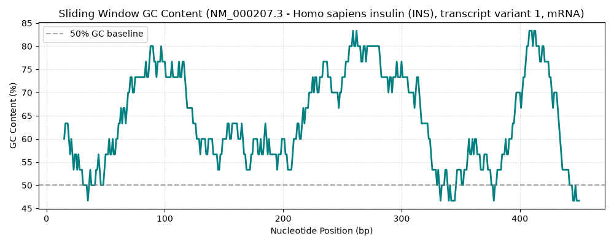

# BioProj: Genomic Sequence Analysis Toolkit

A Python bioinformatics suite for automated sequence retrieval, open reading frame (ORF) discovery, comparative alignment, and GC-content visualization.

## Features
- **NCBI Entrez API Integration:** Automatically fetches GenBank genomic data.
- **6-Frame ORF Finder:** Scans positive and reverse strands across all 3 reading frames for START (`ATG`) and STOP codons (`TAA`, `TAG`, `TGA`).
- **GC-Content Analysis:** Computes sliding-window GC percentages and visualizes genomic variation using Matplotlib.

## Repository Structure
- `dna.py` - Core DNA manipulation and codon logic.
- `gene_analyzer.py` - NCBI Entrez sequence retriever.
- `orf_finder.py` - 6-frame translation and ORF detection algorithms.
- `plot_gc.py` - Sliding-window GC-content plotting script.
- `gc_content_plot.png` - Generated GC-content output plot.

## Example Output


## Getting Started
1. Clone the repository:
   ```bash
   git clone [https://github.com/RobD25/bioproj.git](https://github.com/RobD25/bioproj.git)
   cd bioproj
source venv/bin/activate
python plot_gc.py

